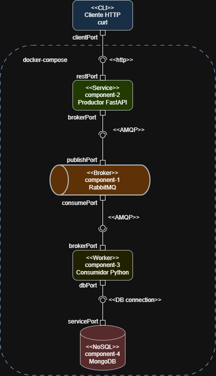
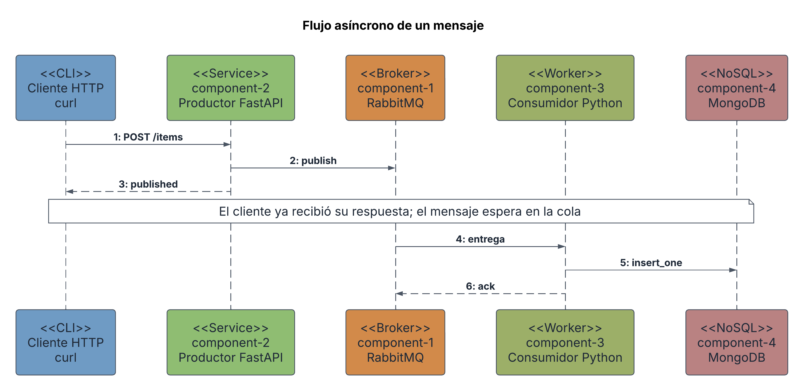
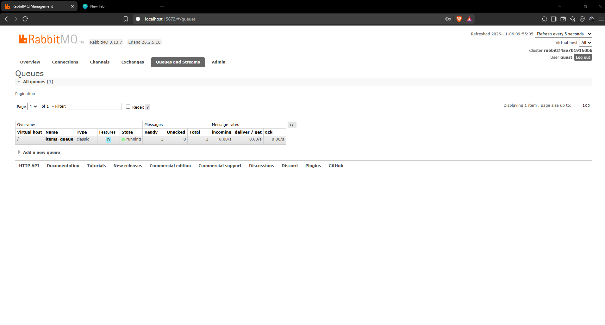
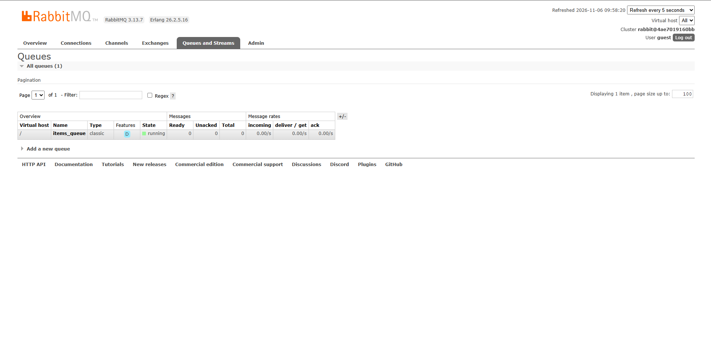
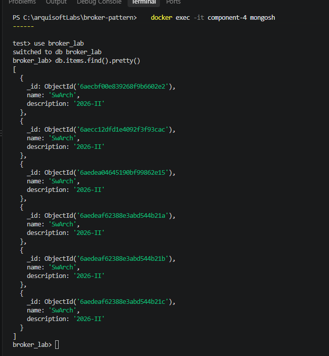

# Laboratorio 3 — Patrones Arquitectónicos Estructurales (Broker)

Raul Felipe Rodríguez Hernández

## Vista de Componentes y Conectores (C&C)



El sistema implementa el patrón arquitectónico **Broker**, con RabbitMQ como intermediario central entre un productor y un consumidor, desplegados con Docker Compose:

- **Productor (`component-2`):** API HTTP (FastAPI) que recibe ítems y los publica en el broker.
- **Broker (`component-1`):** RabbitMQ, que almacena los mensajes en la cola durable `items_queue` y los entrega al consumidor.
- **Consumidor (`component-3`):** worker en Python que toma los mensajes de la cola y los guarda en la base de datos.
- **Base de datos (`component-4`):** MongoDB, donde quedan almacenados los ítems procesados.

El productor y el consumidor nunca se comunican directamente: ambos solo conocen al broker.

## Identificación de componentes y conectores

Los componentes se identificaron a partir de los servicios declarados en `docker-compose.yml`: cada servicio es un elemento con presencia en tiempo de ejecución. `component-2` y `component-3` se construyen a partir de su propio `Dockerfile`, mientras que `component-1` y `component-4` usan imágenes oficiales (`rabbitmq:3-management` y `mongo`), por lo que no requieren código propio.

Los conectores se identificaron siguiendo cómo se comunican los componentes:

- El puerto publicado `8000` y la ruta `POST /items` revelan el conector entre el cliente y el productor.
- La variable de entorno `RABBIT_URL` (`amqp://...`) y el código `aio_pika.connect_robust` revelan los conectores AMQP del productor y del worker con el broker.
- La variable `MONGO_URL` y el código `AsyncIOMotorClient` revelan el conector entre el worker y MongoDB.

## Descripción de los elementos arquitectónicos y relaciones

* __Cliente HTTP (curl):__

Este elemento es un cliente externo al sistema, ejecutado desde la línea de comandos. Es quien inicia el flujo: envía peticiones `POST` al productor a través de su `clientPort`. No se despliega dentro de Docker Compose.

* __component-2 (Productor FastAPI):__

Este elemento es un componente de cómputo de tipo servicio, expuesto en el puerto 8000. Aloja la lógica de negocio para recibir un ítem (`POST /items`), validar que incluya nombre y descripción, y publicarlo como mensaje persistente en la cola. No guarda estado ni se comunica con la base de datos. Responde `published` en cuanto el broker recibe el mensaje.

* __component-1 (Broker RabbitMQ):__

Este elemento es un componente de cómputo de tipo broker, y es el elemento central del patrón. Expone el puerto 5672 (protocolo AMQP) y el puerto 15672 (panel de administración). Recibe los mensajes del productor, los guarda en la cola durable `items_queue` y los entrega al consumidor. Es el único elemento que conocen el productor y el consumidor.

* __component-3 (Consumidor Worker):__

Este elemento es un componente de cómputo de tipo worker, un proceso en segundo plano sin interfaz de usuario. Se suscribe a la cola `items_queue`, procesa cada mensaje recibido y lo guarda en la base de datos. Al terminar de guardarlo, confirma el mensaje al broker.

* __component-4 (MongoDB):__

Este elemento es un componente de almacenamiento, es no relacional (orientado a documentos) y se ocupa de guardar los ítems procesados por el worker, en la colección `items` de la base de datos `broker_lab`. Usa la imagen oficial `mongo`, por lo que no requiere construcción propia.

* __Conector Cliente HTTP - component-2:__

Este conector define una comunicación síncrona en donde el componente emisor de peticiones es el cliente HTTP (`clientPort`) y el receptor es el productor (`restPort`), la comunicación es de tipo http.

* __Conector component-2 - component-1:__

Este conector define una comunicación asíncrona por mensajes en donde el componente emisor es el productor (`brokerPort`) y el receptor es el broker (`publishPort`). El productor entrega el mensaje persistente al broker y continúa sin esperar a que alguien lo consuma, la comunicación es de tipo AMQP y se realiza con la librería `aio-pika`.

* __Conector component-3 - component-1:__

Este conector define una comunicación asíncrona por mensajes en donde el componente que inicia la conexión es el worker (`brokerPort`) y el que la ofrece es el broker (`consumePort`). El worker se suscribe a la cola `items_queue`, el broker le entrega los mensajes cuando están disponibles y el worker confirma (`ack`) cada uno al terminar de procesarlo, la comunicación es de tipo AMQP.

* __Conector component-3 - component-4:__

Este conector define una comunicación de tipo petición-respuesta en donde el componente emisor de peticiones es el worker (`dbPort`) y el receptor es la base de datos MongoDB (`servicePort`), la comunicación es de tipo Database Connection y se realiza con el driver `motor`.

## Descripción de la comunicación asíncrona



El recorrido de un mensaje tiene seis pasos:

1. El cliente envía `POST /items` al productor.
2. El productor publica el mensaje, como mensaje persistente, en la cola `items_queue` del broker.
3. El productor responde `published` al cliente **de inmediato**, sin esperar al worker.
4. De forma independiente, el broker entrega el mensaje al worker cuando este está disponible.
5. El worker inserta el ítem en MongoDB.
6. El worker confirma el mensaje (`ack`) y el broker lo elimina de la cola.

La comunicación es asíncrona porque la respuesta al cliente (paso 3) no depende de lo que ocurre en los pasos 4 a 6. Esto aporta tres propiedades:

- **Desacople temporal:** si el worker está apagado, la API sigue aceptando mensajes y estos esperan en la cola.
- **Durabilidad:** la cola es durable y los mensajes son persistentes, por lo que sobreviven a que el consumidor no esté disponible.
- **Reentrega:** el mensaje solo se elimina de la cola cuando el worker lo confirma. Si el worker falla antes de confirmar, el broker lo vuelve a entregar.

### Evidencia de las pruebas

Con el worker detenido (`docker stop component-3`) se enviaron tres mensajes. La API respondió `published` las tres veces y los mensajes quedaron esperando en la cola (**Ready = 3**):



Al volver a encender el worker (`docker start component-3`), la cola se vació (**Ready = 0**):



Los tres mensajes quedaron almacenados en MongoDB, con identificadores consecutivos:



## Cómo ejecutar el sistema

### Prerrequisitos

- Tener instalado [Docker](https://www.docker.com/) y Docker Compose.
- Que los puertos `8000`, `5672`, `15672` y `27017` estén libres. Si hay otros contenedores usándolos, deténlos antes.

### Pasos

0. **Clonar el repositorio:**
   ```bash
   git clone https://github.com/rrodriguezhe/swarchLab3.git
   cd swarchLab3
   ```

1. **Levantar los contenedores:**
   ```bash
   docker-compose up --build
   ```
   RabbitMQ tarda unos 15 segundos en estar listo. Es normal que `component-3` se reinicie una o dos veces al principio: `restart: on-failure` lo reinicia hasta que el broker acepta conexiones.

2. **Abrir el panel de RabbitMQ:** [http://localhost:15672](http://localhost:15672), con usuario `guest` y contraseña `guest`. En **Queues and Streams** debe aparecer `items_queue` con 1 consumidor.

3. **Enviar un mensaje.** En Linux/macOS:
   ```bash
   curl -X POST http://localhost:8000/items -H "Content-Type: application/json" -d '{"name": "SwArch", "description": "2026-II"}'
   ```
   En PowerShell (donde `curl` es un alias de otro comando):
   ```powershell
   Invoke-RestMethod -Uri "http://localhost:8000/items" -Method POST -ContentType "application/json" -Body '{"name": "SwArch", "description": "2026-II"}'
   ```
   Debe responder `published`.

4. **(Opcional) Ver el log del worker:**
   ```bash
   docker logs component-3
   ```
   Debe aparecer `[x] Item stored: {'name': 'SwArch', 'description': '2026-II'}`.

5. **Verificar en MongoDB:**
   ```bash
   docker exec -it component-4 mongosh
   ```
   ```javascript
   use broker_lab
   db.items.find().pretty()
   ```

6. **Probar el comportamiento asíncrono:**
   1. Detén el worker: `docker stop component-3`.
   2. Envía varios mensajes como en el paso 3. La API sigue respondiendo `published`.
   3. En el panel de RabbitMQ, la columna **Ready** muestra los mensajes en espera.
   4. Enciende el worker: `docker start component-3`. **Ready** vuelve a 0 y los mensajes aparecen en MongoDB.

7. **Detener el sistema:**
   ```bash
   docker-compose down
   ```
